# Sistema de Gestão Acadêmica

## Grupo 03 — Engenharia de Software (2º Semestre)

### Integrantes

| Nome | Responsabilidade |
|------|-----------------|
| Guilherme Mattos dos Santos | Model: classe `Aluno`, enum `Situacao`, `calcularMedia()`, `getSituacao()`, validação de notas |
| Phillipe Santana Gonzaga | Controller: `AlunoController` — cadastrar, listar, buscar, editar, excluir e lançar notas |
| Leonardo Lisboa dos Santos | View: `TelaPrincipal` (navegação) e `TelaCadastroAlunos` com JTable, editar e excluir |
| João Marcos dos Santos Antunes | View: `TelaLancamentoNotas` — escolher aluno, lançar e corrigir as 3 notas, mensagens de erro |
| Douglas Gabriel Barboza Freitas | Controller: `RelatorioController` — média geral, maior média, menor média, quantidade por situação |
| Renato Campos Lopes | View: `TelaConsultaResultados` (consulta individual) e `TelaResultado` (relatório geral) |

---

## Descrição do Projeto

Sistema desktop desenvolvido em **Java puro** com interface gráfica **Swing**, seguindo a arquitetura **MVC (Model–View–Controller)**.

O sistema permite o gerenciamento acadêmico de alunos de uma disciplina, incluindo cadastro, lançamento de notas, consulta de resultados individuais e geração de relatório geral da turma.

Os dados são armazenados em memória utilizando **ArrayList** durante a execução da aplicação.

---

## Funcionalidades Implementadas

### 1. Cadastro de Alunos
- Registrar matrícula, nome completo e turma.
- Listar todos os alunos cadastrados em uma JTable.
- Editar informações de alunos existentes.
- Excluir alunos com confirmação.
- Validação: impede matrícula duplicada e campos vazios.

### 2. Lançamento de Notas
- Selecionar aluno cadastrado via JComboBox.
- Registrar três avaliações (Nota 1, Nota 2, Nota 3).
- Atualizar notas já lançadas.
- Cálculo automático da média aritmética.
- Classificação automática da situação (Aprovado, Recuperação, Reprovado).
- Tabela de acompanhamento com todos os alunos e suas notas.

### 3. Consulta de Resultados
- Buscar aluno por matrícula.
- Exibir notas individuais, média e situação.
- Identificar notas pendentes (ainda não lançadas).

### 4. Relatório Acadêmico
- Média geral da turma.
- Maior e menor média.
- Quantidade de alunos por situação: aprovados, em recuperação, reprovados e pendentes.
- Total de alunos cadastrados.

---

## Regras de Negócio

| Regra | Descrição |
|-------|-----------|
| Notas | Devem estar entre **0** e **10** |
| Matrícula | Não pode ser duplicada |
| Campos obrigatórios | Matrícula, nome e turma são obrigatórios no cadastro |
| Aprovado | Média **≥ 7** |
| Em Recuperação | Média **≥ 5** e **< 7** |
| Reprovado | Média **< 5** |
| Pendente | Quando as três notas ainda não foram lançadas |

---

## Telas do Sistema

Os prints abaixo foram tirados com o sistema em execução, usando os alunos de exemplo da tabela a seguir.

| Matrícula | Nome | Notas | Média | Situação |
|-----------|------|-------|-------|----------|
| 001 | Ana Souza | 9, 8, 10 | 9,00 | Aprovado |
| 002 | Bruno Lima | 6, 5, 7 | 6,00 | Recuperação |
| 003 | Carla Dias | 3, 4, 2 | 3,00 | Reprovado |
| 004 | Diego Rocha | sem notas | — | Pendente |

### Tela principal

Menu de navegação com um botão para cada tela do sistema.

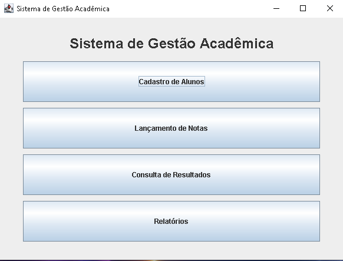

### Cadastro de Alunos

Cadastro de um aluno com mensagem de confirmação:

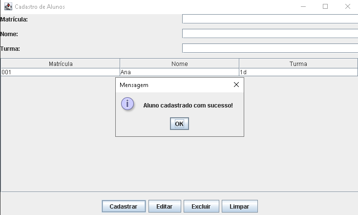

Tentativa de cadastrar uma matrícula que já existe. O sistema recusa e avisa o usuário:

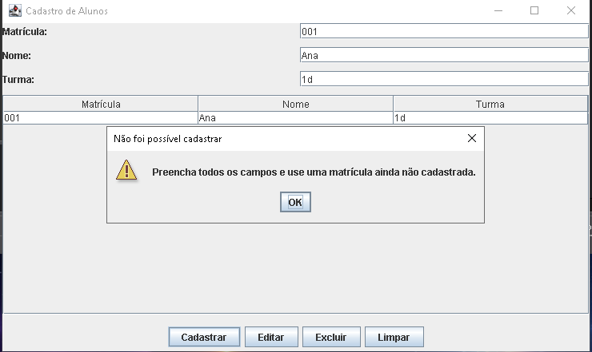

Listagem dos alunos cadastrados na JTable:

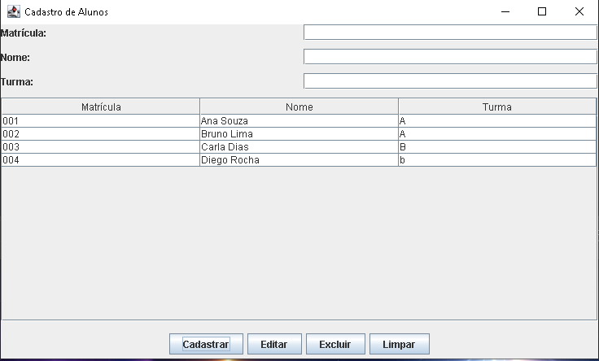

Edição: ao selecionar uma linha da tabela, os dados vão para o formulário e podem ser alterados.

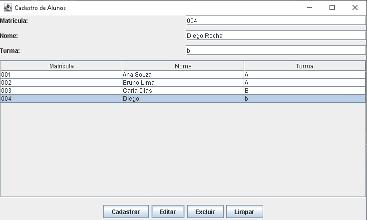

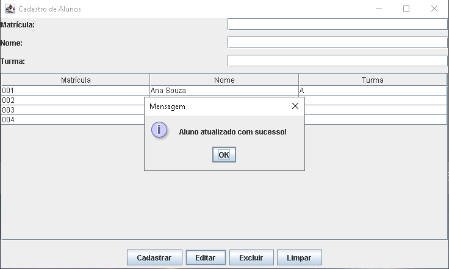

Exclusão, com confirmação antes de remover:

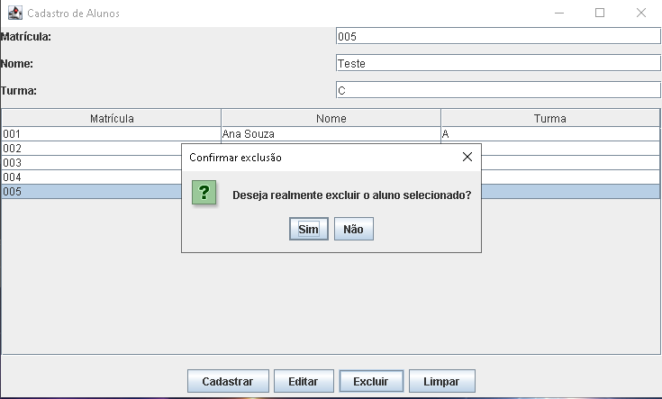

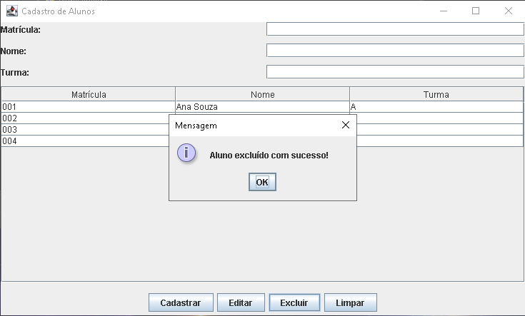

### Lançamento de Notas

Tela inicial, com o aluno selecionado em uma lista, os campos das três notas e a tabela de acompanhamento. Alunos sem notas aparecem como Pendente.

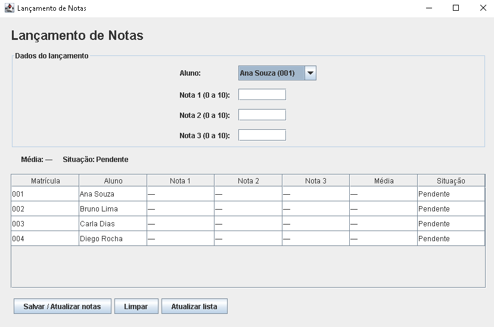

Validação: uma nota fora do intervalo de 0 a 10 é recusada e nada é gravado.

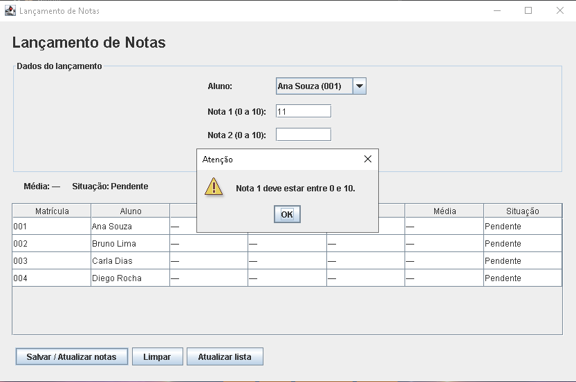

Notas válidas são salvas, e a média e a situação são calculadas na hora.

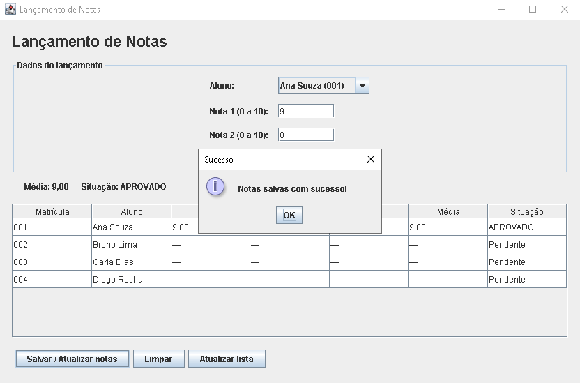

Com todas as notas lançadas, a tabela de acompanhamento mostra a média e a situação de cada aluno:

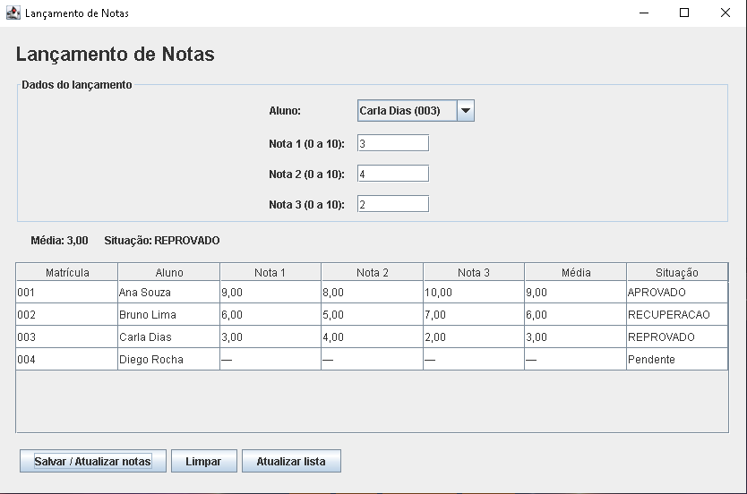

### Consulta de Resultados

Consulta individual por matrícula, com notas, média e situação. Exemplo de um aluno em recuperação:

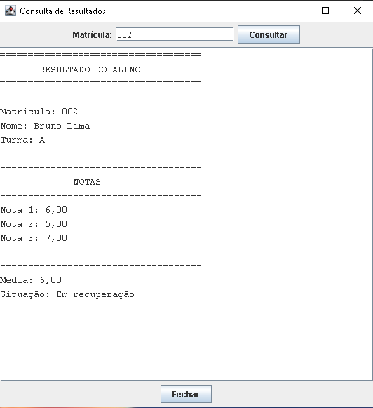

Aluno sem notas lançadas: as notas aparecem como Pendente e a média não é calculada.

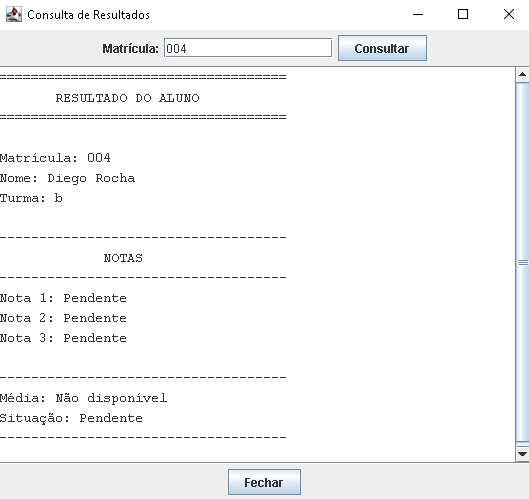

### Relatório Geral

Sem nenhum aluno cadastrado, o relatório informa que não há dados:

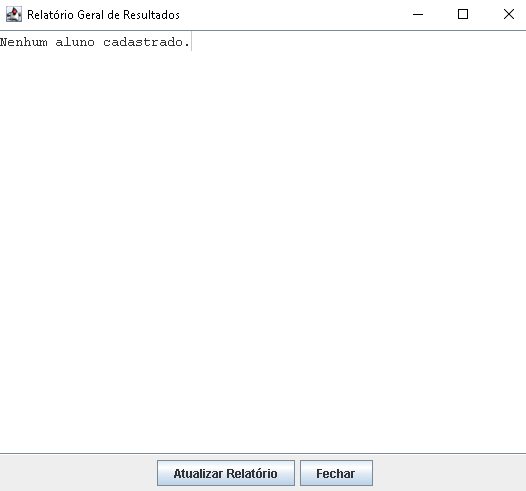

Com os alunos de exemplo, o relatório mostra a média geral, a menor e a maior média, a quantidade de alunos por situação e o total de alunos. O aluno pendente não entra no cálculo das médias.

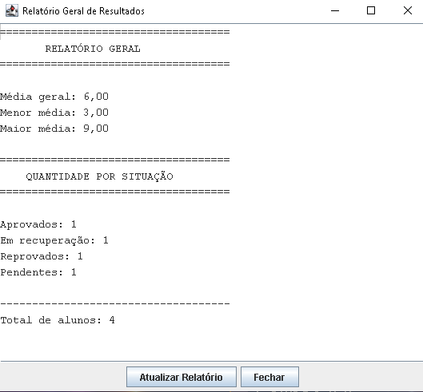

---

## Arquitetura MVC

```
src/
├── model/
│   ├── Aluno.java            ← Dados do aluno, cálculo de média e situação
│   └── Situacao.java         ← Enum: APROVADO, RECUPERACAO, REPROVADO
│
├── controller/
│   ├── AlunoController.java  ← CRUD de alunos e lançamento de notas
│   └── RelatorioController.java ← Cálculos do relatório geral
│
├── view/
│   ├── TelaPrincipal.java         ← Tela principal com navegação
│   ├── TelaCadastroAlunos.java    ← Cadastro, edição e exclusão de alunos
│   ├── TelaLancamentoNotas.java   ← Lançamento e atualização de notas
│   ├── TelaConsultaResultados.java ← Consulta individual por matrícula
│   └── TelaResultado.java         ← Relatório geral da turma
│
└── TesteAluno.java           ← Testes de validação do Model
```

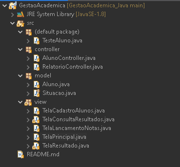

**Model:** responsável pelos dados e regras de negócio (validação de notas, cálculo de média, classificação).

**Controller:** coordena as operações entre a View e o Model (cadastro, busca, edição, exclusão, lançamento de notas e geração de relatórios).

**View:** interface gráfica Swing que exibe informações e recebe ações do usuário, sem conter lógica de negócio.

---

## Tecnologias Utilizadas

- **Linguagem:** Java SE (compila em Java 8 ou superior)
- **Interface gráfica:** Java Swing (JFrame, JPanel, JTextField, JButton, JTable, JComboBox, JOptionPane, JTextArea)
- **Armazenamento:** ArrayList em memória
- **Padrão arquitetural:** MVC

---

## Como Importar no Eclipse

1. Extraia o arquivo ZIP.
2. No Eclipse, acesse **File > Import**.
3. Escolha **General > Existing Projects into Workspace**.
4. Selecione a pasta `GestaoAcademica_Integrado`.
5. Marque o projeto encontrado e clique em **Finish**.

---

## Como Executar

1. Abra o arquivo `src/view/TelaPrincipal.java`.
2. Clique com o botão direito e escolha **Run As > Java Application**.
3. A tela principal será exibida com quatro opções de navegação.

---

## Testes Realizados

### Teste 1 — Cadastro e validação de matrícula duplicada
**O que foi testado:** Cadastrar dois alunos com a mesma matrícula.
**Resultado:** O sistema impediu o cadastro duplicado e exibiu mensagem de aviso, conforme esperado. (Veja o print em [Cadastro de Alunos](#cadastro-de-alunos).)

### Teste 2 — Validação de notas fora do intervalo
**O que foi testado:** Lançar nota com valor 11 (acima do máximo permitido).
**Resultado:** O sistema rejeitou a nota e exibiu mensagem informando que a nota deve estar entre 0 e 10. (Veja o print em [Lançamento de Notas](#lançamento-de-notas).)

### Teste 3 — Cálculo de média e classificação
**O que foi testado:** Lançar notas para verificar cada situação possível.
**Resultados:**
- Notas 7, 7, 7 → Média 7.0 → **APROVADO** ✔
- Notas 5, 5, 5 → Média 5.0 → **RECUPERAÇÃO** ✔
- Notas 4, 5, 5 → Média 4.67 → **REPROVADO** ✔
- Notas 10, 10, 10 → Média 10.0 → **APROVADO** ✔
- Notas 0, 0, 0 → Média 0.0 → **REPROVADO** ✔

Esses casos são executados pela classe `TesteAluno`, que valida o Model pelo console. Saída:

```
7, 7, 7 (esperado APROVADO) -> média 7.0 | APROVADO
5, 5, 5 (esperado RECUPERACAO) -> média 5.0 | RECUPERACAO
4, 5, 5 (esperado REPROVADO) -> média 4.666666666666667 | REPROVADO
10, 10, 10 (esperado APROVADO) -> média 10.0 | APROVADO
0, 0, 0 (esperado REPROVADO) -> média 0.0 | REPROVADO
OK nota 11: Nota deve estar entre 0 e 10
Somente duas notas lançadas: false | média: 0.0
```

Na interface, a classificação aparece na tabela de acompanhamento (veja em [Lançamento de Notas](#lançamento-de-notas)).

### Teste 4 — Relatório com alunos sem notas
**O que foi testado:** Gerar relatório quando há alunos cadastrados mas sem notas lançadas.
**Resultado:** O sistema exibiu a mensagem "Não existem médias disponíveis" e contabilizou os alunos como "Pendentes", conforme esperado.

---

## Observações

- Os dados ficam armazenados em memória enquanto a aplicação está aberta.
- Ao fechar o programa, os cadastros são perdidos (não há banco de dados ou persistência em arquivo).
- Um único `AlunoController` é compartilhado entre todas as telas, garantindo que os dados sejam consistentes em toda a aplicação.
